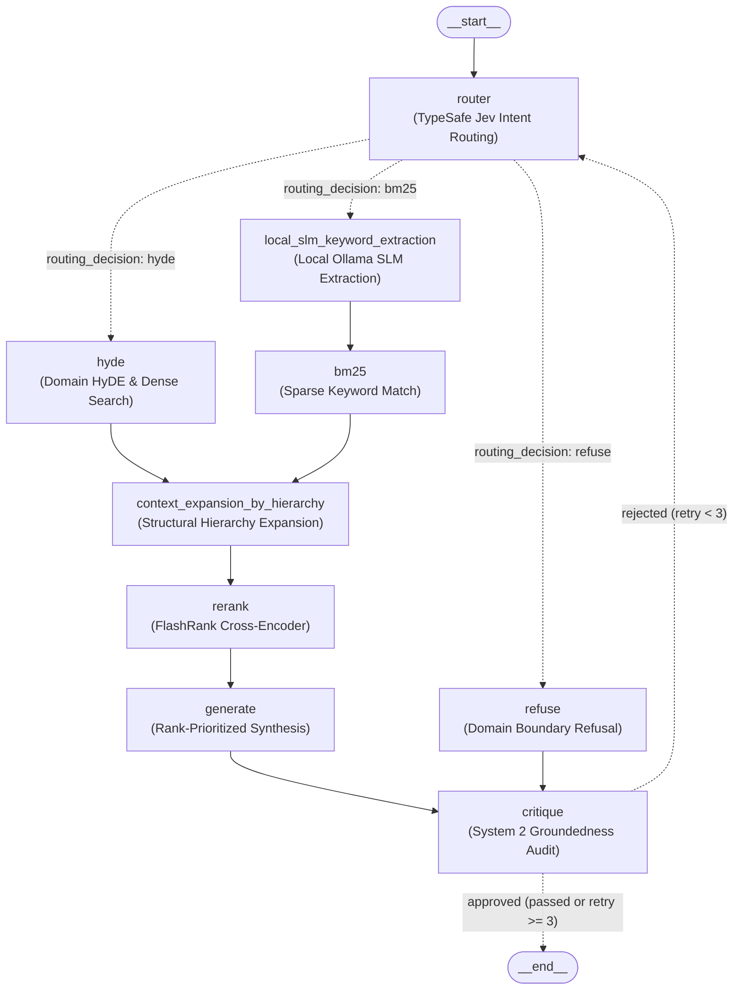
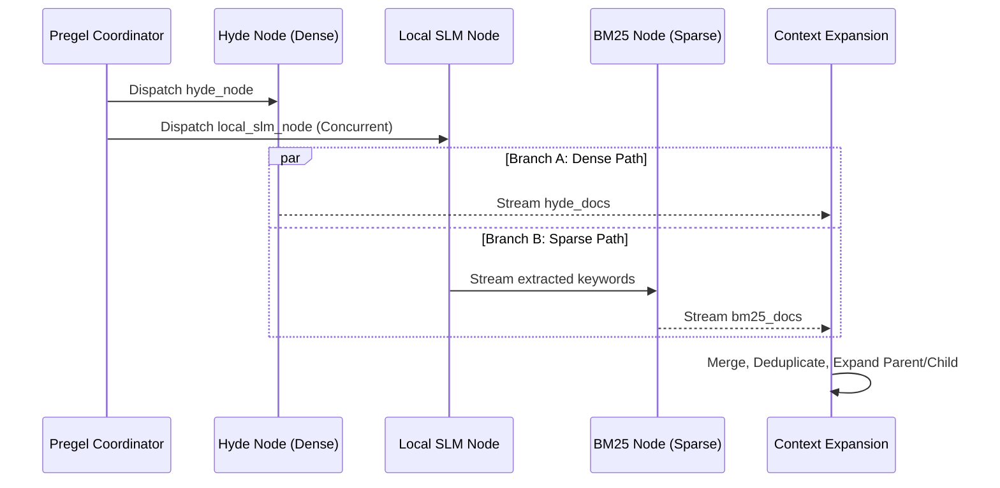

# AI Agent Construction: LangGraph & Pregel Architecture

This document details the agent orchestration engine powering `documentation-chatbot`, focusing on LangGraph's Pregel execution runtime, asynchronous concurrency, state management, and the self-critique reflection loop.

---

## 1. Core Architecture Overview

The agent is modeled as a compiled state machine (`src/agent_flow/graph.py`) using LangGraph's `StateGraph`. Unlike sequential chains (e.g., standard LangChain runnables), LangGraph models the system as a directed cyclic graph with explicit state mutation, enabling dynamic routing, branch parallelization, and reflection cycles.



---

## 2. Pregel Graph Concurrency vs. Blocking Sync

### The Latency Bottleneck
In early implementations, retrieval operations ran in a synchronous waterfall sequence:
```text
Query -> Router -> Keyword Extraction -> BM25 Search -> Dense Vector Search -> Context Merge
```
Total retrieval latency was strictly additive:
$$T_{total} = T_{router} + T_{slm} + T_{bm25} + T_{dense} + T_{rerank}$$
Under this blocking pattern, average query latencies frequently exceeded 5.5 seconds.

### Transition to True Concurrency
LangGraph executes on top of the **Pregel message-passing algorithm**. When a parent node (e.g., `router` emitting `hyde_bm25`) dispatches edges to multiple child nodes, Pregel evaluates those branches in parallel execution super-steps:



By decoupling independent tasks into concurrent branches, retrieval latency drops to:
$$T_{retrieval} \approx \max(T_{hyde}, T_{slm} + T_{bm25}) + T_{expand} + T_{rerank}$$
This architectural change brought P95 latency down under 3.8 seconds.

---

## 3. Stateful Graph Schema

The state contract is defined in `src/agent_flow/state.py`. LangGraph guarantees thread safety by passing immutable state snapshots between nodes and recording updates:

```python
# region State Definition
from typing import Annotated, TypedDict
from langchain_core.documents import Document

class AgentState(TypedDict):
    query: str
    routing_decision: str           # "refuse" | "bm25" | "hyde" | "hyde_bm25"
    bm25_query: str                 # Distilled keywords produced by local SLM
    bm25_docs: list[Document]
    hyde_docs: list[Document]
    hypothetical_doc: str
    expanded_docs: list[Document]   # Post-hierarchy expansion pool
    ranked_docs: list[Document]     # Top candidates after FlashRank
    draft_response: str
    citations: list[str]
    is_critique_passed: bool        # Gate flag for conditional termination
    critique_feedback: str          # Feedback passed into retry generation
    retry_count: int                # Guard against infinite self-reflection cycles
# endregion
```

---

## 4. System 2 Self-Critique & Reflection Loop

### Mechanism
Standard RAG pipelines emit LLM output directly to the client, creating significant exposure to hallucinated parameters or unsupported claims. 

In `documentation-chatbot`, generation is governed by a **System 2 Reflection Gate** (`critique_node`):
1. **Auditing**: A dedicated judge model inspects the `draft_response` against the exact text in `ranked_docs`.
2. **Citation Validation**: Checks whether each cited topic tag (e.g., `[Topic Name]`) exists in the retrieved document metadata.
3. **Branching**:
   - If verified (`is_critique_passed=True`): Route directly to `END`.
   - If ungrounded or citations are missing: Increments `retry_count`, injects `critique_feedback` into state, and routes back to `router` for query refinement.
4. **Infinite Loop Guard**: A strict ceiling (`retry_count >= 3`) breaks any cyclic reflection loops, ensuring deterministic termination and preventing unbounded token consumption.
