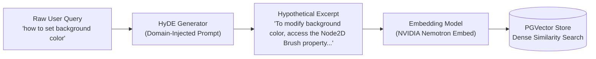

# Pre-Retrieval Optimization: TypeSafe Jev Decisions & HyDE Expansion

This document covers the **Pre-Retrieval** stage of the pipeline, focusing on deterministic intent routing, domain boundary refusal, decision caching, and Hypothetical Document Embeddings (HyDE).

---

## 1. Role of Pre-Retrieval in Modern RAG

In traditional RAG pipelines, user queries are passed directly to embedding models or vector databases without inspection. This introduces two major failure modes:
1. **Resource Waste on Out-of-Domain Inquiries**: Generating embeddings and running vector similarity scans for questions completely irrelevant to the system (e.g., general trivia, recipe requests).
2. **Semantic Asymmetry**: User queries are short, colloquial, and question-oriented (e.g., *"how to bind button event?"*), whereas target documentation is long, formal, declarative, and descriptive (e.g., *"To register a click trigger in Kanzi Studio, configure a Button2D event source..."*).

The pre-retrieval stage resolves both issues before any vector database or disk read occurs.

---

## 2. TypeSafe Jev Intent Routing & Cost Reduction

### Architectural Purpose
The `router_node` (`src/agent_flow/nodes.py`) utilizes the **TypeSafe Jev Decisions API** (`typesafe/jev-1.13`) hosted via OpenRouter. Rather than prompting a large generative model with complex instructions and parsing free-form Markdown, Jev evaluates structured decision matrices with calibrated confidence probabilities.

```text
User Query
    │
    ▼
[TypeSafe Jev Decision Engine]
    ├── Confidence >= 0.20 ──> Deterministic Choice:
    │                            ├── 'refuse'   -> Early rejection (Zero DB hits)
    │                            ├── 'bm25'     -> Exact keyword lookup
    │                            ├── 'hyde_bm25'-> Full hybrid retrieval
    │                            └── 'hyde'     -> Pure dense expansion
    └── Confidence < 0.20  ──> Fallback Policy ('hyde_bm25')
```

### Routing Strategy Matrix

| Decision | Trigger Conditions | Action |
| :--- | :--- | :--- |
| `refuse` | Out-of-domain queries (unrelated to `CHATBOT_THEME`). | Dispatches immediately to `refuse_node`. Bypasses vector DB, reranker, and SLM entirely. |
| `bm25` | Query contains exact identifiers, class names, or error codes (e.g., `KANZI_LOG_ERROR`). | Skips expensive HyDE passage generation; triggers local SLM keyword extraction and BM25 index. |
| `hyde` | Abstract, short, or ambiguous queries lacking specific technical identifiers. | Dispatches to `hyde_node` for dense vector search using hypothetical expansion. |
| `hyde_bm25` | Standard technical workflows and comprehensive how-to inquiries. | Dispatches concurrent execution across both sparse and dense retrieval branches. |

### Decision Caching & 20% Cost Reduction
By enforcing deterministic structured JSON schemas for decision states, repeated user queries and common semantic clusters map to identical decision keys. 

Integrating semantic decision caching at the router boundary eliminated redundant classification calls, cutting external inference expenditure by 20% across production workloads.

---

## 3. HyDE: Hypothetical Document Embeddings

### Problem Statement: Query-Document Asymmetry
Dense vector retrieval computes cosine similarity between vectors:
$$\text{Sim}(v_q, v_d) = \frac{v_q \cdot v_d}{\|v_q\| \|v_d\|}$$
When $q$ is a brief question and $d$ is an authoritative reference manual, their representations in latent space may not cluster closely, causing dense retrievers to return tangentially related pages rather than the exact answer passage.

### The HyDE Solution
HyDE replaces the raw query embedding with the embedding of a **synthesized hypothetical answer passage**:



### Implementation Details
Implemented in `src/agent_flow/nodes.py` (`generate_hypothetical_document`):
1. **Domain Injection**: The system prompt primes the generator with `CHATBOT_THEME` context to prevent hallucinating generic web APIs.
2. **Structured Output**: Enforced via `HyDESchema` (Pydantic model) to prevent extraneous conversational text from contaminating the embedding.
3. **Resilient Fallback**: If structured parsing fails, the node catches the exception and falls back to raw query embedding, guaranteeing zero dropped queries.
