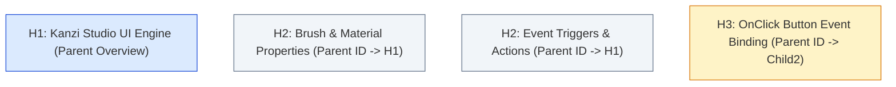

# Retrieval & Ranking: Hierarchical Heading Trees, Hybrid Search & FlashRank

This document details the multi-stage retrieval architecture, contrasting deterministic hierarchical indexing against canonical RAPTOR, and covering sparse/dense hybrid retrieval with in-memory neural cross-encoder reranking.

---

## 1. Architectural Clarification: Hierarchical Indexing vs. Canonical RAPTOR

While earlier design iterations and legacy variable names in the codebase (e.g., `raptor_layer`, `raptor_chunks`) referenced RAPTOR, **the production pipeline does not use canonical RAPTOR**. 

Understanding this distinction is critical for system accuracy and engineering observability:

| Dimension | Canonical RAPTOR (Sarthi et al., 2024) | Implemented Hierarchical Architecture |
| :--- | :--- | :--- |
| **Tree Construction** | Bottom-up unsupervised clustering (Gaussian Mixture Models / UMAP) of raw text embeddings. | Top-down structural parsing of documentation DOM / Markdown heading trees (`H1` to `H4`). |
| **Node Content** | Synthetic, lossy LLM-generated abstractive summaries of clustered documents. | Exact author-written document overviews, official topic breadcrumbs, and section texts. |
| **Ingestion Cost & Latency** | High computational overhead; hundreds of recursive LLM summarization API calls per document. | Near-zero ingestion overhead; pure deterministic AST/DOM parsing via Crawl4AI. |
| **Code & API Fidelity** | Prone to losing exact parameter names, types, or syntax inside LLM-summarized clusters. | 100% preservation of verbatim code snippets, API signatures, and error codes. |

For technical documentation systems, deterministic **Structural Heading Trees (Small-to-Big Retrieval)** consistently outperform unsupervised semantic clustering (RAPTOR) by preventing synthetic hallucination at the ingestion layer.

---

## 2. The Retrieval Dilemma: Precision vs. Context Window

Standard RAG systems face an inherent conflict when sizing text chunks:
- **Small Chunks (e.g., 200–500 characters)**: Yield high retrieval precision and accurate cosine similarity scores, but lack surrounding architectural context and operational prerequisites.
- **Large Chunks (e.g., 2000–4000 characters)**: Retain necessary background context, but dilute vector embeddings with unrelated sentences, degrading vector search accuracy.

The system resolves this dilemma via **Small-to-Big Parent-Document Expansion**.

---

## 3. Structural Hierarchy & Small-to-Big Retrieval

### 4-Stage Ingestion Pipeline (`dataset/crawl/`)
The documentation ingestion pipeline structures unstructured HTML into a relational document tree:
1. `1.crawler.py`: Crawls documentation using Crawl4AI.
2. `2.structure_hierarchy.py`: Parses HTML header tags (`H1` to `H4`) to construct an explicit tree. Each node stores `id`, `parent_id`, and pre-computed `child_ids`.
3. `3.split_chunks.py`: Splits large leaf sections while preserving heading lineage and breadcrumbs.
4. `4.ingest_pgvector.py`: Batches embeddings into PostgreSQL `langchain_pg_embedding` table with `cmetadata` JSONB containing lineage pointers.



### Dynamic Small-to-Big Expansion (`context_expansion_by_hierarchy`)
When a granular leaf chunk (e.g., `Grandchild1`) is retrieved:
1. The node extracts its `parent_id` from metadata.
2. It looks up the parent chunk in `_hierarchy_map` (`src/vector_db.py`).
3. The parent overview is prepended to the candidate context.
4. Related sibling or child subtopics (`child_ids`) are appended.

This ensures the LLM receives the exact answer without losing macro-level operational context.

---

## 4. Hybrid Retrieval: BM25 Sparse + PGVector Dense

Dense vector embeddings frequently struggle with exact technical keywords, API names (e.g., `Node2D::setProperty`), and hex error codes because sub-word tokenizers break unfamiliar technical tokens into arbitrary sub-tokens.

To guarantee zero retrieval dropouts, the system executes **hybrid retrieval**:

```text
               User Query
                   │
         ┌─────────┴─────────┐
         ▼                   ▼
 [Dense PGVector]     [In-Memory BM25]
  Semantic Meaning     Exact API & Identifiers
         │                   │
         └─────────┬─────────┘
                   ▼
       [Deduplicate & Merge Pool]
                   │
                   ▼
     [Hierarchical Expansion]
```

- **In-Memory BM25 Retriever**: Constructed directly from in-memory document tokens for fast token-level inverse document frequency scoring ($<15\text{ms}$).
- **PGVector pg16 Store**: Provides cosine distance indexing for semantic conceptual matching.

---

## 5. Neural Reranking: FlashRank Cross-Encoder

### Bi-Encoder (Vector DB) vs. Cross-Encoder (Reranker)
Bi-encoders compute vector embeddings of queries and documents independently:
$$\text{Score}_{bi} = \langle \mathbf{E}(q), \mathbf{E}(d) \rangle$$
This is fast, but ignores cross-attention interactions between query tokens and document tokens.

Cross-encoders concatenate the query and document into a single transformer input:
$$\text{Score}_{cross} = \text{Transformer}([q; d])$$
All query tokens attend directly to all document tokens, yielding significantly more reliable relevance rankings.

### FlashRank In-Memory Execution
Rather than invoking external paid reranking APIs or deploying heavy GPU cross-encoders, the system embeds **FlashRank** (`src/llm_client.py`):
- Runs lightweight, quantized cross-encoders directly in-process.
- Employs lazy initialization (`_LazyReranker`) to prevent cold-start import latency.
- Reranks top 15–20 hybrid candidates down to top 5 high-fidelity context passages.

This hybrid + reranker combination improved context precision from `0.4937` to `0.9280` on evaluation benchmarks.
