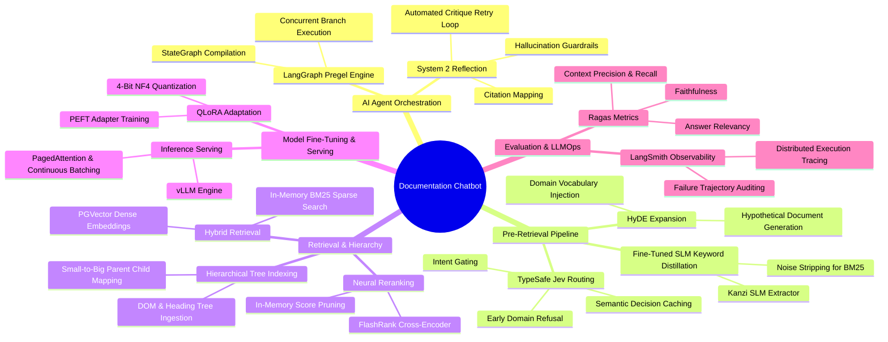

# Technical Concepts & Architecture Index

This documentation suite provides a deep technical breakdown of the engineering concepts, design decisions, and optimizations powering the `documentation-chatbot` system.

---

## 1. System Taxonomy & Concept Mind Map

The following declarative Mermaid mind map outlines all core modules, runtime nodes, optimization strategies, and evaluation toolchains implemented across the repository:

---

## 2. 3-Stage Pipeline & Metric-Driven Optimization Matrix

The architecture maps directly to the 3-stage RAG paradigm demonstrated in competitive benchmarks (such as the Meta KDD Cup '24 CRAG challenge):

| Pipeline Stage | Primary Concepts & Technologies | Architectural Purpose | Reference Guide |
| :--- | :--- | :--- | :--- |
| **Agent Core** | LangGraph, Pregel Engine, System 2 Critique | Stateful workflow execution, true asynchronous concurrency, and self-correcting generation loops. | [01_AGENT_ARCHITECTURE_LANGGRAPH.md](01_AGENT_ARCHITECTURE_LANGGRAPH.md) |
| **Pre-Retrieval** | TypeSafe Jev Decisions, HyDE, SLM Distillation | Deterministic intent classification, domain boundary enforcement, query caching, and hypothetical semantic expansion. | [02_PRE_RETRIEVAL_JEV_HYDE.md](02_PRE_RETRIEVAL_JEV_HYDE.md) |
| **Retrieval & Rerank** | Hierarchical Heading Trees, BM25, PGVector, FlashRank | Hierarchical small-to-big context expansion, exact keyword matching, dense semantic similarity, and cross-encoder reranking. | [03_HYBRID_RETRIEVAL_HIERARCHICAL_BM25_FLASHRANK.md](03_HYBRID_RETRIEVAL_HIERARCHICAL_BM25_FLASHRANK.md) |
| **SLM & Serving** | QLoRA, Qwen2.5 Base, vLLM, PagedAttention | Low-latency 4-bit fine-tuned keyword distillation model served with continuous batching. | [04_SLM_FINE_TUNING_QLORA_VLLM.md](04_SLM_FINE_TUNING_QLORA_VLLM.md) |
| **LLMOps & Evaluation** | Ragas Benchmark Suite, LangSmith Tracing | Groundedness validation, hallucination rate baselines, prompt engineering iterations, and distributed telemetry. | [05_EVALUATION_LLMOPS_RAGAS_LANGSMITH.md](05_EVALUATION_LLMOPS_RAGAS_LANGSMITH.md) |

---

## 3. Metric-Driven Evolution Summary

Each technology was introduced to solve an empirical failure mode identified during testing:

1. **Cost Optimization (-20% Inference Spend)**:
   - *Driver*: Repeated similar queries and expensive classification prompts drained API budgets.
   - *Solution*: TypeSafe Jev decision routing with confidence-based caching and deterministic early exits (`refuse`).
2. **Parallelism & Latency (P95 <= 3.8s)**:
   - *Driver*: Synchronous waterfall retrieval (SLM -> BM25 -> Dense Vector) created prohibitive latency.
   - *Solution*: Redesigned LangGraph Pregel graph flow to execute HyDE generation and SLM keyword extraction concurrently.
3. **Retrieval Precision (+31% Context Recall)**:
   - *Driver*: Vector-only search missed exact API symbols, while naive BM25 missed semantic intent.
   - *Solution*: Hybrid PGVector + BM25 combined with structural heading hierarchy preservation (`parent_id`/`child_ids`) and FlashRank reranking.
4. **Accuracy & Faithfulness (>= 0.96 Faithfulness)**:
   - *Driver*: Base LLMs introduced conversational noise into search queries and hallucinated unsupported API features.
   - *Solution*: QLoRA fine-tuned 4-bit SLM for query distillation coupled with System 2 critique reflection before answer emission.
5. **High-Throughput Serving (Minimal GPU Memory Footprint)**:
   - *Driver*: Standard Hugging Face transformer serving exhibited memory fragmentation and sequential queuing under load.
   - *Solution*: Exported QLoRA adapter merged with base weights, converted to GGUF, and served via vLLM with PagedAttention and continuous batching.
